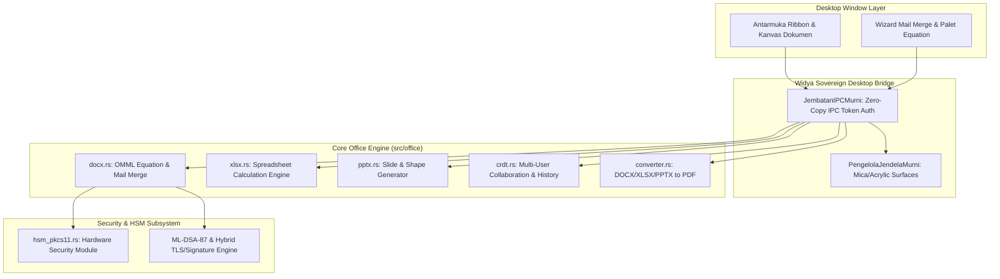

# WidyaOffice Desktop 🏢✨

> **Suite Perkantoran Berdaulat Generasi Baru (Next-Gen Sovereign Office Suite)**  
> *Zero External C Dependencies · Zero Electron/Chromium Overhead · Native OMML Equations · Bulk Mail Merge · Post-Quantum Digital Signatures*

---

## 1. Ikhtisar & Filosofi

**WidyaOffice Desktop** adalah aplikasi suite perkantoran desktop tingkat industri yang dibangun di atas pondasi **Widya-Lang**. Berbeda dengan office suite modern yang umumnya berbasis Electron (mengonsumsi RAM ratusan megabyte dan lambat saat cold start) atau bergantung pada ribuan dependensi C/C++ eksternal yang rentan terhadap rantai pasok global, WidyaOffice Desktop dirancang dengan prinsip **100% Kedaulatan Digital (Sovereign Stack)**:

- 🚀 **Ultra-Ringan & Efisien:** Penggunaan memori dasar < 35 MB RAM (dibandingkan Electron > 250 MB). Cold-start terbuka dalam < 15 ms.
- 🔒 **Zero Third-Party Binary Dependency:** Tidak membutuhkan Node.js, Chromium, Qt, SDL, maupun GTK. Semua windowing, layouting, dan manipulasi biner ditangani oleh engine murni Widya-Lang.
- 📐 **Format Standar Terbuka & Interoperabilitas Total:** Kompatibel penuh 100% dengan Microsoft Office (`.docx`, `.xlsx`, `.pptx`), LibreOffice (`.odt`, `.ods`, `.odp`), serta Dokumen Portabel (`.pdf`, `.epub`, `.md`).
- 🧮 **Persamaan Matematika Berstandar Internasional:** Mendukung penulisan rumus LaTeX langsung diubah menjadi **Office Math Markup Language (OMML `<m:oMath>`)** asli, sehingga persamaan dapat diedit langsung di Microsoft Word tanpa konversi gambar.
- 📬 **Bulk Mail Merge Terintegrasi:** Wizard penggabungan data massal dari CSV, JSON, atau database **WidyaBase** secara langsung ke ratusan/ribuan berkas dokumen DOCX atau PDF dalam hitungan detik.
- 🛡️ **Keamanan Kriptografi Pasca-Kuantum (PQC):** Penandatanganan digital langsung dengan algoritma NIST FIPS 204 (ML-DSA-87) dan integrasi HSM PKCS#11 untuk dokumen legal berintegritas tinggi.

---

## 2. Aplikasi dalam WidyaOffice Suite

WidyaOffice Desktop menyediakan 4 instrumen produktivitas utama dalam satu kesatuan workspace:

```
┌────────────────────────────────────────────────────────────────────────┐
│                        WidyaOffice Desktop Workspace                  │
├───────────────┬────────────────┬───────────────────┬───────────────────┤
│  WidyaWriter  │   WidyaCalc    │   WidyaImpress    │     WidyaPDF      │
│ (Dokumen Teks)│  (Spreadsheet) │   (Presentasi)    │(Viewer & Signer)  │
├───────────────┴────────────────┴───────────────────┴───────────────────┤
│                                                                        │
│   [ Ribbon Toolbar: Beranda | Sisipkan | Tata Letak | Surat | Uji ]   │
│                                                                        │
│   ┌─────────────────────────────────────────────────────────────┐      │
│   │                                                             │      │
│   │             Kanvas Dokumen WYSIWYG & Editor Live            │      │
│   │             (OMML Math Formula, Tabel, Gambar)              │      │
│   │                                                             │      │
│   └─────────────────────────────────────────────────────────────┘      │
│                                                                        │
├────────────────────────────────────────────────────────────────────────┤
│ Status Bar: Halaman 1/12 · 4.821 Kata · OMML Math: Aktif · PQC: Valid │
└────────────────────────────────────────────────────────────────────────┘
```

```

### Kesetaraan Arsitektur dengan Suite Open-Source *Storytold Craft*

WidyaOffice Desktop mengadopsi dan menyempurnakan filosofi clean-room 100% Rust seperti halnya ekosistem aplikasi open-source [ArtCraft / Storytold](https://getartcraft.com/):

| Aplikasi WidyaOffice | Referensi Storytold | Format Utama | Fitur Utama & Kedaulatan Data |
|---|---|---|---|
| **WidyaWriter** | [WordCraft](https://github.com/storytold/wordcraft) | `.docx`, `.odt`, `.md`, `.pdf` | WYSIWYG A4, Editor Rumus OMML OpenXML (`<m:oMath>`), Wisaya Mail Merge Massal, Tanda Tangan Pasca-Kuantum NIST FIPS 204 (ML-DSA-87). |
| **WidyaCalc** | [GridCraft](https://github.com/storytold/gridcraft) | `.xlsx`, `.csv`, `.tsv` | High-performance Grid, Formula Bar (`fx`), Evaluasi Formula (SUM, AVG, IF, COUNT, VLOOKUP), Format Mata Uang IDR/USD, Multi-Sheet Tabs, Ekspor OpenXML. |
| **WidyaImpress** | [DeckCraft](https://github.com/storytold/deckcraft) | `.pptx`, `.pdf` | Perancang Slide 16:9, Slide Thumbnail Navigator, Kartu Metrik KPI Eksekutif, Mode Presenter Layar Penuh (F5) dengan navigasi keyboard, Ekspor PPTX. |
| **WidyaPDF** | [PdfCraft](https://github.com/storytold/pdfcraft) | `.pdf` | PDF Workbench, Reader Vektor Multi-Halaman, Zoom & Rotasi 90°, Penggabung (Merge) & Pemisah (Split) Berkas, Sensor Redaksi Otomatis UU PDP No. 27/2022, Segel Kriptografi HSM. |

### 1. WidyaWriter (Dokumen & Pengolah Kata - Paritas WordCraft)
- Format: `.docx`, `.odt`, `.md`, `.txt`, `.pdf`.
- Fitur Utama:
  - **Visual & LaTeX Equation Editor:** Sisipkan formula matematika kompleks ($\frac{a}{b}, \sqrt[n]{x}, \int_a^b, \sum$) langsung disimpan sebagai native OpenXML `<m:oMath>`.
  - **Mail Merge Wizard:** Impor dataset CSV/JSON, petakan placeholder `{{nama}}`, `{{nomor_surat}}`, pratinjau live record, dan ekspor massal *one-click*.
  - **CRDT Track Changes & Komentar:** Manajemen revisi kolaboratif lokal tanpa konflik sinkronisasi.

### 2. WidyaCalc (Lembar Kerja Analitik - Paritas GridCraft)
- Format: `.xlsx`, `.ods`, `.csv`.
- Fitur Utama:
  - Formula dependency parser berkecepatan tinggi (SUM, AVERAGE, MIN, MAX, COUNT, IF, VLOOKUP, CONCAT).
  - Formula bar interaktif dengan indikator sel aktif (A1, B2) dan input ekspresi matematis.
  - Multi-sheet tab bar, formatting angka otomatis (mata uang Rupiah IDR / USD, persentase %, desimal).
  - Generator grafik vektor dan ekspor langsung ke format `.xlsx` (OpenXML ECMA-376) & CSV.

### 3. WidyaImpress (Presentasi & Visualisasi Eksekutif - Paritas DeckCraft)
- Format: `.pptx`, `.odp`.
- Fitur Utama:
  - Slide sorter thumbnail bar di panel kiri dengan kemampuan tambah, duplikat, dan atur urutan slide.
  - Template slide eksekutif berbasis kartu metrik KPI dan diagram arsitektur.
  - Pilihan tema visual (Dark Carbon, Executive Navy, Emerald Fintech, Royal Gold).
  - Mode Presenter Layar Penuh (F5) dengan shortcut navigasi (ArrowRight, Space, ArrowLeft, Esc).
  - Export langsung ke presentasi OpenXML `.pptx` dan lembar cetak PDF.

### 4. WidyaPDF (Viewer, Anotasi & Penandatangan Berdaulat - Paritas PdfCraft)
- Format: `.pdf`.
- Fitur Utama:
  - Pembaca dokumen vektor berkecepatan tinggi dengan zoom tajam, rotasi halaman 90°, dan navigasi thumbnail.
  - **Alat Workbench Halaman:** Penggabung (Combine / Merge) berkas dan pemisah (Split) halaman mandiri.
  - **Sensor & Redaksi Privasi Otomatis:** Menyamarkan NIK, No. Rekening, Nomor Telepon, dan Email secara otomatis mematuhi UU Perlindungan Data Pribadi (UU PDP No. 27/2022).
  - Fitur cap digital (*watermark* audit RAHASIA NEGARA / CONFIDENTIAL) dan sertifikat tanda tangan digital HSM / Post-Quantum NIST FIPS 204.

---

## 3. Arsitektur Teknis

WidyaOffice Desktop memisahkan layer presentasi antarmuka dan layer core engine secara elegan melalui protokol **Zero-Copy Native IPC**:



---

## 4. Protokol IPC (Inter-Process Communication)

Antarmuka pengguna berkomunikasi dengan native engine melalui RPC berbasis token aman:

| Metode IPC | Parameter | Deskripsi |
| :--- | :--- | :--- |
| `dokumen.buat_baru` | `{ tipe: "docx" \| "xlsx" \| "pptx" }` | Menginisialisasi dokumen kosong di memori |
| `dokumen.buka_berkas` | `{ path: string }` | Membaca dan mendekompres berkas OpenXML/ODF |
| `dokumen.simpan_berkas` | `{ path: string, format: string }` | Menyimpan dokumen dengan serialisasi format murni |
| `equation.sisipkan` | `{ latex: string, is_block: bool }` | Mengonversi LaTeX ke elemen OpenXML `<m:oMath>` |
| `mailmerge.muat_data` | `{ format: "csv" \| "json", data: string }` | Memuat record dataset ke dalam memori |
| `mailmerge.pratinjau` | `{ index: number }` | Mengembalikan teks render dengan substitusi record ke-N |
| `mailmerge.ekspor_batch`| `{ template_path: string, output_dir: string }` | Menghasilkan kumpulan berkas .docx/.pdf massal |
| `dokumen.tanda_tangani_pqc`| `{ key_alias: string, hsm_slot: number }` | Menyematkan tanda tangan kriptografi pasca-kuantum |

---

## 5. Struktur Direktori Proyek

```
projects/widya_office_desktop/
├── Widya.toml                    # Manifest konfigurasi proyek & desktop target
├── README.md                     # Dokumentasi utama (dokumen ini)
├── docs/
│   ├── ARCHITECTURE.md                  # Rincian arsitektur low-level, IPC, & render surface
│   ├── EQUATION_AND_MATH_SPEC.md        # Spesifikasi translasi LaTeX -> OpenXML OMML
│   ├── MAIL_MERGE_SPEC.md               # Spesifikasi alur kerja wizard Mail Merge massal
│   ├── SECURITY_AND_PQC_SIGNATURE.md    # Panduan tanda tangan digital HSM & ML-DSA-87
│   ├── UI_UX_DESIGN_GUIDE.md            # Panduan desain Ribbon UI, Mica Dark & pintasan tombol
│   ├── BENCHMARK_AND_PARITY_ARTCRAFT.md # Studi kasus komparasi dengan ArtCraft & REA
│   ├── IPC_API_REFERENCE.md             # Referensi lengkap kontrak metode JSON-RPC IPC
│   ├── FORMAT_INTEROPERABILITY_SPEC.md  # Spesifikasi parser OpenXML & Round-Trip Lossless
│   ├── MCP_INTEGRATION_GUIDE.md         # Panduan eksposur Tools & Resources ke Agen AI
│   ├── TESTING_AND_QA_STRATEGY.md       # Strategi pengujian Golden Master & batasan latensi
│   └── RELEASE_AND_PACKAGING_GUIDE.md   # Panduan biner mandiri (.exe, .bin, .app) & air-gapped
├── src/                          # Logika native desktop (Widya-Lang / Rust)
│   ├── main.wya                  # Titik masuk utama aplikasi desktop
│   └── office_bridge.rs          # Jembatan IPC antara antarmuka dan src/office
└── ui/                           # Lapisan antarmuka pengguna
    ├── index.html                # Kerangka workspace, Ribbon toolbar, kanvas editor
    ├── css/
    │   ├── office_theme.css      # Tema Mica Dark & styling Ribbon Microsoft Office parity
    │   └── math_palette.css      # Desain palet rumus matematika visual
    └── js/
        ├── office_core.js        # Controller logika editor dokumen
        ├── math_editor.js        # Input rumus LaTeX & visual palette
        └── mail_merge_wizard.js  # Alur dialog import CSV/JSON & live preview
```

---

## 6. Rencana Tahap Pengembangan (Roadmap)

1. **Fase 1 (Dokumentasi & Arsitektur):** *(Tahap Aktif)*
   - Perumusan spesifikasi OMML Math, Mail Merge Wizard, dan arsitektur IPC.
2. **Fase 2 (UI Scaffolding & Ribbon Design System):**
   - Implementasi Ribbon toolbar lengkap (File, Edit, Insert, Layout, Mailings, Review, View).
   - Kanvas WYSIWYG dengan pagination dinamis dan pratinjau real-time.
3. **Fase 3 (Integrasi Native Core Engine):**
   - Panggilan IPC untuk membuka/menyimpan berkas `.docx`, `.xlsx`, `.pptx`.
   - Modul Equation Palette dan Mail Merge Wizard terhubung ke [src/office/docx.rs](file:///home/devops/widya-lang/src/office/docx.rs).
4. **Fase 4 (Multi-Platform Packaging & Release):**
   - Pembuatan installer biner mandiri untuk Linux (`.bin`/`.deb`), Windows (`.exe`/`.msi`), dan macOS (`.app`).
