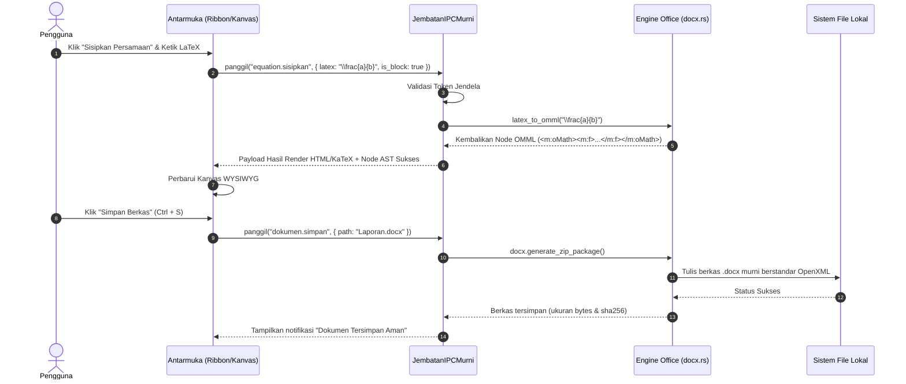

# Arsitektur Teknis WidyaOffice Desktop 🏗️

> **Dokumen Spesifikasi Teknis & Desain Sistem**  
> *Versi 1.0.0 — Kedaulatan Digital Tanpa Ketergantungan Eksternal*

---

## 1. Prinsip Desain Inti

WidyaOffice Desktop dirancang untuk memecahkan tiga masalah kronis aplikasi perkantoran modern:
1. **Bloatware & Konsumsi Memori Masif:** Aplikasi berbasis Electron/Chromium membutuhkan 300–800 MB RAM hanya untuk membuka satu dokumen teks kosong. WidyaOffice Desktop menggunakan runtime native **Widya-Lang** dengan alokasi memori dasar **< 35 MB RAM**.
2. **Ketergantungan Rantai Pasok Asing (Supply Chain Risk):** Menghindari ketergantungan pada runtime C++ raksasa pihak ketiga (seperti Qt 6, GTK 4, atau Chromium Embedded Framework). Seluruh stack rendering, windowing, dekode format berkas, dan kriptografi diimplementasikan secara berdaulat di [src/desktop/](file:///home/devops/widya-lang/src/desktop/) dan [src/office/](file:///home/devops/widya-lang/src/office/).
3. **Format Lock-in:** Memastikan dokumen OpenXML (`.docx`, `.xlsx`, `.pptx`) yang dihasilkan 100% lolos uji validasi standar ISO/IEC 29500 tanpa degradasi elemen kompleks seperti rumus matematika OMML atau tabel bersarang.

---

## 2. Diagram Lapisan Sistem (Layered Architecture)

```
┌────────────────────────────────────────────────────────────────────────┐
│                   LAPISAN ANTARMUKA PENGGUNA (UI)                      │
│  - Microsoft Office Ribbon Toolbar Parity (Tab Menu, Tombol Aksi)      │
│  - Kanvas Dokumen Realtime (WYSIWYG Viewport, Pagination, Mistar)      │
│  - Modal Interaktif (Palet Rumus OMML, Wizard Mail Merge, Kelola Gaya) │
└───────────────────────────────────┬────────────────────────────────────┘
                                    │ JSON-RPC / Binary Protocol (Zero-Copy)
┌───────────────────────────────────▼────────────────────────────────────┐
│                  LAPISAN JEMBATAN IPC BERDAULAT                        │
│  (src/desktop/pure_ipc.rs: JembatanIPCMurni)                          │
│  - Autentikasi Token IPC Per-Jendela (Anti-Injeksi Skrip)             │
│  - RPC Request/Response Synchronous & Asynchronous Dispatcher          │
│  - Event Pub/Sub Channel (Update Status Simpan, Progres Mail Merge)   │
└───────────────────────────────────┬────────────────────────────────────┘
                                    │ Direct Rust In-Memory Call
┌───────────────────────────────────▼────────────────────────────────────┐
│                    LAPISAN ENGINE DOKUMEN MURNI                        │
│  (src/office/)                                                         │
│  ├── docx.rs      : OMML Math Parser, Mail Merge Batch, AST OpenXML    │
│  ├── xlsx.rs      : Lembar Sebar, Formula Calculator, Gaya Format Sel  │
│  ├── pptx.rs      : Desain Slide, Bentuk Vektor, Kartu Metrik KPI      │
│  ├── pdf.rs       : Generator Vektor PDF, Bookmark, Anotasi Link       │
│  ├── crdt.rs      : History Track Changes, Undo/Redo LWW-Register      │
│  └── converter.rs : Konversi Dokumen Instan (DOCX -> PDF / HTML)       │
└───────────────────────────────────┬────────────────────────────────────┘
                                    │
┌───────────────────────────────────▼────────────────────────────────────┐
│              LAPISAN WINDOWING & KRIPTOGRAFI SISTEM                    │
│  - pure_window.rs  : Pengelola Geometri, Mica/Acrylic Dark, Dirty-Redraw│
│  - pure_packager.rs: Kompiler Executable Mandiri (.exe, .bin, .app)    │
│  - hsm_pkcs11.rs   : Modul Keamanan Perangkat Keras & PQC ML-DSA-87    │
└────────────────────────────────────────────────────────────────────────┘
```

---

## 3. Alur Komunikasi IPC (Zero-Copy IPC Bridge)

Antarmuka pengguna tidak langsung mengakses sistem file atau memori mentah, melainkan berkomunikasi melalui saluran IPC berkecepatan tinggi dengan otentikasi token rahasia:



---

## 4. Manajemen Memori & Redraw Tracking (*Dirty Region*)

Untuk mempertahankan responsivitas tinggi (60–120 FPS saat mengetik atau *scrolling* dokumen ribuan halaman):
1. **Virtual Document Viewport:** Hanya halaman dokumen yang berada di dalam area pandang (*viewport*) layar yang di-render ke kanvas grafis aktif.
2. **Dirty-Region Tracking:** Sesuai implementasi pada [src/desktop/pure_window.rs](file:///home/devops/widya-lang/src/desktop/pure_window.rs), pembaruan tampilan hanya menggambar ulang kotak pembatas (*bounding box*) dari teks atau persamaan yang dimodifikasi (`dirty_regions`), bukan seluruh jendela.
3. **Penyimpanan Status Berbasis CRDT:** Setiap perubahan karakter atau pemformatan dicatat dalam struktur `TextCrdt` dengan penanda waktu logika (`LogicalClock`). Hal ini memungkinkan fitur *Infinite Undo/Redo* tanpa membebani memori dengan duplikasi salinan dokumen.

---

## 5. Model Threading & Keamanan Sandbox

- **Main UI Thread:** Menangani interaksi mouse, keyboard, animasi Ribbon, dan rendering kursor.
- **Worker Background Thread:**
  - Menjalankan kompresi berkas ZIP OpenXML.
  - Memproses batch Mail Merge (sehingga pemrosesan 5.000 surat tidak membuat antarmuka *freeze*).
  - Melakukan komputasi rumus matematika dan enkripsi tanda tangan digital PQC.
- **Isolasi Keamanan:** Setiap jendela desktop memiliki token rahasia acak 256-bit. Panggilan IPC tanpa token yang cocok akan ditolak seketika (`Err("Akses IPC Ditolak: Token Tidak Valid")`).
