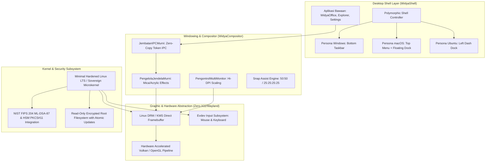

# WidyaOS 🇮🇩💻

> **Sistem Operasi Desktop Berdaulat Generasi Baru (Next-Gen Sovereign Desktop OS)**  
> *Shell Polimorfik Dinamis (Windows · macOS · Ubuntu) · Suite Produktivitas Bawaan · Booting < 2 Detik · Kriptografi Pasca-Kuantum*

---

## 1. Ikhtisar & Filosofi Kedaulatan

**WidyaOS** adalah sistem operasi desktop independen yang dirancang untuk memberikan kemandirian teknologi menyeluruh (*digital sovereignty*) bagi instansi pemerintah, BUMN, institusi pendidikan, militer, dan masyarakat umum. 

Berbeda dengan sistem operasi konvensional yang mengunci pengguna dalam satu paradigma visual kaku dan dipenuhi telemetri rahasia asing, WidyaOS menghadirkan inovasi revolusioner:

1. 🎭 **Shell Polimorfik Tri-Persona (Windows · macOS · Ubuntu):**  
   Pengguna dapat mengubah tata letak antarmuka desktop sesuai kenyamanan kerja hanya dengan **1-klik tanpa perlu me-restart komputer**:
   - **Mode Windows:** Taskbar di bawah, tombol Start di kiri/tengah, tombol kontrol jendela di kanan atas.
   - **Mode macOS:** Global Menu Bar di atas, Floating Dock aplikasi melayang di bawah, tombol lampu lalu lintas (*traffic lights*) di kiri atas.
   - **Mode Ubuntu:** Left Dash Dock vertikal di sisi kiri, Top Bar status di atas.
2. 💼 **Aplikasi Bawaan Siap Pakai (*Batteries-Included*):**  
   Begitu instalasi selesai, sistem langsung dilengkapi suite produktivitas perkantoran lengkap **WidyaOffice Desktop** (WidyaWriter, WidyaCalc, WidyaImpress, WidyaPDF), pengelola berkas **WidyaExplorer**, terminal akselerasi GPU **WidyaTerminal**, dan pusat kendali **WidyaSettings**.
3. ⚡ **Kinerja Ekstrem & Ringan (Sub-2-Second Boot):**  
   - Waktu boot dingin dari tombol daya ditekan hingga desktop siap pakai: **< 2 detik**.
   - Konsumsi RAM sistem idle: **< 250 MB RAM** (dibandingkan Windows 11 yang membutuhkan 4–8 GB RAM). Dapat berjalan sangat mulus di laptop lawas (RAM 2 GB - 4 GB) maupun workstation canggih.
4. 🛡️ **Bebas Telemetri Asing & Anti-Kuantum (PQC):**  
   - 100% *air-gapped friendly*, tanpa telemetri tersembunyi yang mengirim data ke server luar negeri.
   - Keamanan sistem operasi dilindungi oleh algoritma NIST FIPS 204 (ML-DSA-87) dan integrasi modul perangkat keras HSM PKCS#11 ([src/kripto/hsm_pkcs11.rs](file:///home/devops/widya-lang/src/kripto/hsm_pkcs11.rs)).

---

## 2. Tiga Persona Antarmuka WidyaOS (Polymorphic Shell)

```
┌────────────────────────────────────────────────────────────────────────┐
│               1. MODE WINDOWS (Default Korporat & Bisnis)              │
│                                                                        │
│   ┌──────────────────────────────────────────────────────────────┐     │
│   │  Jendela Aplikasi (WidyaWriter / WidyaCalc)            [_][口][X]│
│   │                                                              │     │
│   └──────────────────────────────────────────────────────────────┘     │
│                                                                        │
│ ┌────────────────────────────────────────────────────────────────────┐ │
│ │ [Start Nusantara]  [Writer] [Calc] [Explorer]      [WiFi] [PQC] [ Jam]│ │
│ └────────────────────────────────────────────────────────────────────┘ │
└────────────────────────────────────────────────────────────────────────┘

┌────────────────────────────────────────────────────────────────────────┐
│                 2. MODE MACOS (Kreatif, Desain, & Akademik)            │
│ ┌────────────────────────────────────────────────────────────────────┐ │
│ │  File  Edit  View  Insert  Tools  Window  Help   [WiFi] [PQC] [ Jam]│ │
│ └────────────────────────────────────────────────────────────────────┘ │
│                                                                        │
│   ┌──────────────────────────────────────────────────────────────┐     │
│   │ [x][-][+]  Jendela Aplikasi (WidyaImpress / WidyaPDF)        │     │
│   │                                                              │     │
│   └──────────────────────────────────────────────────────────────┘     │
│                                                                        │
│            ┌───────────────────────────────────────────────┐           │
│            │  (Dock Melayang): [Finder] [Writer] [Calc] [⚙] │           │
│            └───────────────────────────────────────────────┘           │
└────────────────────────────────────────────────────────────────────────┘

┌────────────────────────────────────────────────────────────────────────┐
│                 3. MODE UBUNTU (Pengembang, Engineer, & Riset)         │
│ ┌────────────────────────────────────────────────────────────────────┐ │
│ │ Activities             WidyaOS Enterprise         [WiFi] [PQC] [ Jam]│ │
│ ├──────┬─────────────────────────────────────────────────────────────┤ │
│ │ [Apps│   ┌─────────────────────────────────────────────────────┐   │ │
│ │ [Wrt]│   │ [x][-][+]  WidyaTerminal (GPU PTY)                  │   │ │
│ │ [Clc]│   │                                                     │   │ │
│ │ [Exp]│   └─────────────────────────────────────────────────────┘   │ │
│ │ [Term│                                                             │ │
│ │ [Set]│                                                             │ │
│ └──────┴─────────────────────────────────────────────────────────────┘ │
└────────────────────────────────────────────────────────────────────────┘
```

---

## 3. Paket Aplikasi Bawaan (Default App Suite)

| Aplikasi Bawaan | Ikon / Peran | Fitur Utama |
| :--- | :--- | :--- |
| **WidyaWriter** | 📝 Dokumen Teks | Formula matematika OMML (`<m:oMath>`), Bulk Mail Merge, kompatibilitas Word (.docx). |
| **WidyaCalc** | 📊 Lembar Kerja | Kalkulasi formula berkecepatan tinggi, tabel gaya cerdas, kompatibilitas Excel (.xlsx). |
| **WidyaImpress**| 📽️ Presentasi | Template eksekutif, kartu KPI, bentuk vektor, kompatibilitas PowerPoint (.pptx). |
| **WidyaPDF** | 📕 Pembaca Dokumen | Perenderan vektor tajam, anotasi link, penandatanganan elektronik pasca-kuantum (PQC). |
| **WidyaExplorer**| 📁 Pengelola Berkas | Navigasi drive SSD/NVMe instan, pratinjau dokumen internal, manajemen partisi terenkripsi. |
| **WidyaTerminal**| 💻 Konsol Sistem | Terminal akselerasi GPU berbasis PTY, integrasi asisten AI berdaulat via MCP CLI. |
| **WidyaSettings**| ⚙️ Pusat Kendali | Pengatur persona tampilan 1-klik (Win/Mac/Ubuntu), resolusi layar, jaringan, dan kunci HSM. |
| **WidyaStore** | 🛍️ Pusat Aplikasi | Manajer paket berdaulat berbasis WPM (Widya Package Manager) & WebAssembly Components. |

---

## 4. Arsitektur Teknis Sistem



---

## 5. Struktur Direktori Proyek

```
projects/widya_os/
├── Widya.toml                    # Konfigurasi OS, edisi, persona default, dan aplikasi bawaan
├── README.md                     # Dokumentasi pengantar (berkas ini)
└── docs/
    ├── ARCHITECTURE.md                  # Arsitektur sistem operasi low-level & memori
    ├── POLYMORPHIC_SHELL_SPEC.md        # Spesifikasi teknis Tri-Persona (Win, Mac, Ubuntu)
    ├── BUILTIN_APPLICATIONS.md          # Spesifikasi lengkap aplikasi bawaan WidyaOS
    ├── BUILTIN_UTILITIES_SPEC.md        # Spesifikasi 8 utilitas harian (Archive, Media 4K, Calc)
    ├── DISPLAY_SERVER_AND_COMPOSITOR.md # Spesifikasi renderer DRM/KMS bebas X11
    ├── SECURITY_AND_PQC_KERNEL.md       # Keamanan anti-kuantum & sistem berkas atomik
    ├── VIRUS_AND_MALWARE_DEFENSE.md     # Arsitektur kekebalan virus, worm, macro & ransomware
    ├── FROM_SCRATCH_DISTRIBUTED_AI_BLOCKCHAIN.md # Arsitektur microkernel dari nol, P2P mesh, AI & DID
    ├── DISTRIBUTED_COMPUTE_MARKETPLACE.md        # Spesifikasi sewa jasa komputasi & langganan WidyaGrid
    ├── WIDYAWORKSPACE_SUBSCRIPTION_AND_1TB_STORAGE.md # Spesifikasi langganan cloud storage 1 TB & tarif
    ├── BACKBONE_SERVER_MANAGEMENT.md             # Pengelolaan server backbone, cluster 8+4 & admin
    ├── WIDYA_EMAIL_SOVEREIGN_SERVICE.md          # Layanan email berdaulat @widya.email terintegrasi
    ├── AFFORDABLE_CLOUD_INFRASTRUCTURE_GUIDE.md  # Panduan hosting terjangkau (Hetzner, R2, IDCloudHost)
    ├── FEASIBILITY_AND_BEP_CALCULATION.md        # Studi kelayakan finansial & kalkulasi BEP (21 user)
    ├── WIDYASERVER_OS_SPEC_AND_SETUP.md          # Spesifikasi WidyaServerOS headless & tuning kernel
    ├── SERVER_STORAGE_AND_WORKSPACE_SETUP.md     # Panduan teknis backend storage 1 TB & deduplikasi CAS
    ├── FILESYSTEM_AND_STORAGE_COMPATIBILITY.md   # Spesifikasi WidyaFS CoW & interoperabilitas NTFS, FAT32, ext4, APFS
    └── BOOT_AND_INSTALLATION_GUIDE.md   # Panduan pembuatan ISO, bootloader UEFI & instalasi
```
