# Arsitektur Tingkat Rendah Sistem Operasi WidyaOS 🏗️

> **Spesifikasi Arsitektur Kernel, Init System, Compositor & Ruang Pengguna**  
> *Sovereign Appliance Paradigm · Booting < 2 Detik · Konsumsi Memori Idle < 250 MB RAM*

---

## 1. Paradigma Desain Sistem

Sebagian besar distribusi sistem operasi komersial atau distro Linux umum mengalami fenomena **"Bloatware Akumulatif"**:
- Ratusan daemon latar belakang yang tidak perlu aktif saat booting.
- Lapisan perantara grafis yang tumpang tindih (*X11 server tua, D-Bus lambat, Display Manager berlapis*).
- Akibatnya: Booting memakan waktu 20–45 detik, dan memori RAM terpakai 2,5–4 GB hanya untuk menampilkan layar kosong.

**WidyaOS** mengadopsi paradigma **Sovereign Minimal Appliance Architecture**:
1. **Kernel Ramping & Mengeras (*Hardened Minimal Kernel*):** Hanya memuat subsistem memori, penjadwal thread (scheduler), driver perangkat keras DRM/KMS, USB/Evdev input, jaringan, dan modul kriptografi.
2. **Init System Mandiri (*WidyaInit*):** Menggantikan systemd raksasa dengan proses init murni yang menyelesaikan pohon dependensi layanan dalam waktu < 20 milidetik dengan penggunaan memori < 2 MB RAM.
3. **Direct-to-GPU Compositor (*WidyaCompositor*):** Melewati X11 dan Wayland bridge yang lambat; shell desktop langsung menulis piksel grafis ke framebuffer kartu grafis melalui antarmuka kernel Linux DRM/KMS.

---

## 2. Diagram Tumpukan Sistem (Full System Stack)

```
┌────────────────────────────────────────────────────────────────────────┐
│                   APLIKASI PENGGUNA (USER APPLICATIONS)                │
│  - WidyaOffice Desktop (Writer, Calc, Impress, PDF)                    │
│  - WidyaExplorer, WidyaTerminal, WidyaSettings, WidyaStore             │
├────────────────────────────────────────────────────────────────────────┤
│                  SHELL POLIMORFIK (WIDYASHELL)                         │
│  - Adaptive Engine: Switcher Persona (Windows, macOS, Ubuntu)          │
│  - Window Management: Snap Assist, Z-order, Mica/Acrylic Transparency  │
├────────────────────────────────────────────────────────────────────────┤
│                 JEMBATAN IPC BERDAULAT (PURE IPC)                      │
│  - Unix Domain Sockets Berkecepatan Tinggi (Zero-Copy Shared Memory)   │
│  - Autentikasi Token Kriptografi Per-Aplikasi                          │
├────────────────────────────────────────────────────────────────────────┤
│            DISPLAY SERVER & COMPOSITOR (WIDYACOMPOSITOR)               │
│  - Pengontrol Multi-Monitor (pure_display.rs: Hi-DPI & Hotplug)        │
│  - Dirty-Region Redraw Engine (pure_window.rs: 60-120 FPS V-Sync)      │
├────────────────────────────────────────────────────────────────────────┤
│                      INIT SYSTEM (WIDYAINIT)                           │
│  - Manajemen Layanan Paralel, Pengawas Daemon (Supervisor Engine)      │
├────────────────────────────────────────────────────────────────────────┤
│               HARDWARE ABSTRACTION LAYER (HAL) KERNEL                  │
│  - Direct Rendering Manager (DRM) & Kernel Mode Setting (KMS)          │
│  - Evdev Input Layer (Mouse, Touchpad, Keyboard, Layar Sentuh)         │
│  - ALSA Sound Core, Netlink Network Subsystem, Cryptoki PKCS#11        │
├────────────────────────────────────────────────────────────────────────┤
│                  PERANGKAT KERAS FISIK (HARDWARE)                      │
│  - Arsitektur CPU: x86_64 (Intel/AMD) & AArch64 (ARM64 / Apple/Pi)     │
│  - GPU: Intel Iris/Arc, AMD Radeon, NVIDIA, Mali, Apple GPU            │
│  - Modul Kripto: Hardware Security Module (HSM) & TPM 2.0              │
└────────────────────────────────────────────────────────────────────────┘
```

---

## 3. Garis Waktu Booting Cepat (< 2 Detik)

```mermaid
gantt
    title Garis Waktu Booting Dingin WidyaOS (Target: < 2.000 ms)
    dateFormat X
    axisFormat %s ms

    section Firmware
    Inisialisasi UEFI / POST              :0, 450
    section Bootloader
    WidyaBoot EFI Loader                  :450, 650
    section Kernel
    Dekompresi & Inisialisasi Kernel      :650, 1100
    Deteksi Driver DRM/KMS & NVMe SSD     :1100, 1400
    section Init & Grafik
    Eksekusi WidyaInit                    :1400, 1480
    Start WidyaCompositor & GPU Framebuffer:1480, 1750
    Pemuatan WidyaShell & Tampilan Desktop :1750, 1950
```



---

## 4. Alokasi & Anggaran Memori (Memory Budget)

WidyaOS dirancang sangat hemat sumber daya, menjadikannya sistem operasi paling efisien untuk berbagai skenario:

| Komponen Sistem | Konsumsi RAM Windows 11 | Konsumsi RAM Ubuntu 24.04 | Konsumsi RAM WidyaOS |
| :--- | :--- | :--- | :--- |
| **Kernel & Driver Dasar** | ~1.200 MB | ~650 MB | **~110 MB** |
| **Init & System Daemons** | ~900 MB | ~450 MB | **~25 MB** |
| **Display Server & Compositor**| ~650 MB (DWM) | ~500 MB (Mutter/Wayland)| **~45 MB** |
| **Desktop Shell & Taskbar** | ~450 MB | ~300 MB | **~50 MB** |
| **TOTAL SISTEM IDLE** | **~3.200 MB (3,2 GB)**| **~1.900 MB (1,9 GB)** | **< 230 MB (~0,23 GB)** |

> 💡 **Dampak Nyata:** Pada komputer dengan RAM 4 GB, Windows 11 sudah menghabiskan 80% RAM hanya untuk booting. Pada WidyaOS, masih tersisa **> 3,7 GB RAM bebas** untuk membuka dokumen tebal, spreadsheet jutaan baris, atau kompilasi kode berkecepatan tinggi!

---

## 5. Model Keamanan Sistem Berkas (*Immutable RootFS*)

Untuk mencegah malware, ransomware, atau kerusakan sistem akibat salah konfigurasi:
1. **Partisi Sistem Tidak Dapat Diubah (*Read-Only RootFS*):** Direktori `/usr`, `/bin`, dan sistem inti disimpan dalam partisi terkompresi *read-only* (ERFS/SquashFS) yang ditandatangani dengan kunci **Ed25519** dan hash **PQC ML-DSA-87**.
2. **Pembaruan Sistem Bebas Risiko (*A/B Atomic Updates*):** Pembaruan sistem operasi diunduh dan dipasang pada partisi B di latar belakang. Jika terjadi kegagalan boot, sistem otomatis melakukan *rollback* ke partisi A dalam 1 detik.
3. **Penyimpanan Pengguna Terenkripsi Penuh (*Encrypted Home Storage*):** Seluruh dokumen di `/home` dilindungi oleh modul enkripsi perangkat keras AES-256-GCM / ChaCha20-Poly1305 yang terintegrasi dengan modul HSM PKCS#11.
