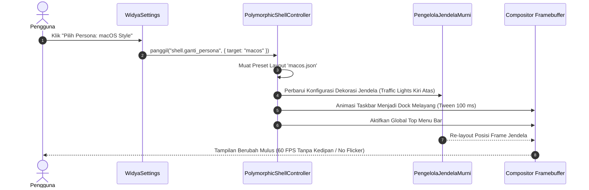

# Spesifikasi Shell Polimorfik Dinamis (Windows · macOS · Ubuntu) 🎭

> **Spesifikasi Teknis Engine Antarmuka Pengguna WidyaOS**  
> *Tri-Persona Adaptive Desktop · Transisi Seketika Tanpa Restart (< 100 ms) · Ergonomi Tanpa Batas*

---

## 1. Filosofi & Latar Belakang

Dalam ekosistem sistem operasi tradisional, pengguna terkunci dalam satu paradigma visual:
- Pengguna Windows terbiasa dengan **Taskbar di bawah** dan tombol kontrol di **kanan atas**.
- Pengguna macOS terbiasa dengan **Menu Bar di atas**, **Dock melayang**, dan tombol lampu lalu lintas di **kiri atas**.
- Pengguna Ubuntu/Linux terbiasa dengan **Dash Dock vertikal di kiri** dan tombol **Activities di pojok kiri atas**.

Ketika suatu instansi atau korporat melakukan migrasi ke sistem operasi baru, kendala nomor 1 adalah **resistensi pengguna terhadap perubahan kebiasaan visual**. 

**WidyaOS** memecahkan masalah ini dengan menghadirkan **Polymorphic Shell**: sebuah arsitektur desktop cerdas di mana pengguna dapat memilih dan mengganti persona antarmuka (mirip Windows, macOS, atau Ubuntu) cukup dengan **1-klik di panel pengaturan atau kombinasi tombol `Super + Tab + P` tanpa perlu me-restart komputer atau menutup dokumen yang sedang dibuka**.

---

## 2. Rincian Tiga Persona Antarmuka

```
┌────────────────────────────────────────────────────────────────────────┐
│                        TRI-PERSONA DESKTOP ENGINE                      │
├────────────────────┬────────────────────┬──────────────────────────────┤
│ 1. Mode Windows    │ 2. Mode macOS      │ 3. Mode Ubuntu               │
│ (Nusantara-Win)    │ (Nusantara-Mac)    │ (Nusantara-Unity)            │
├────────────────────┼────────────────────┼──────────────────────────────┤
│ Taskbar Bawah      │ Menu Bar Atas      │ Status Bar Atas              │
│ Start Menu Kiri/Mid│ Floating Dock      │ Left Dash Dock Vertikal      │
│ Kontrol Kanan Atas │ Kontrol Kiri Atas  │ Kontrol Kanan/Kiri Atas      │
│ Win+Snap Assist    │ Mac Spotlight (⌘Sp)│ Activities Window Exposé     │
└────────────────────┴────────────────────┴──────────────────────────────┘
```

---

### A. Persona 1: Windows Style ("Nusantara-Win")
*Didesain untuk kenyamanan pengguna korporat, perbankan, instansi pemerintah, dan pengguna umum Windows 10/11.*

```
┌────────────────────────────────────────────────────────────────────────┐
│                                                                        │
│   ┌──────────────────────────────────────────────────────────────┐     │
│   │  WidyaWriter - Perjanjian_Kerja.docx                   [_][口][X]│
│   │                                                              │     │
│   └──────────────────────────────────────────────────────────────┘     │
│                                                                        │
│ ┌────────────────────────────────────────────────────────────────────┐ │
│ │ [Start] [Cari] [Writer] [Calc] [Explorer]         [IDR] [PQC] [Jam]│ │
│ └────────────────────────────────────────────────────────────────────┘ │
└────────────────────────────────────────────────────────────────────────┘
```

- **Bilah Tugas (Taskbar Bawah):**
  - Tinggi 48px, melekat di sisi bawah layar dengan efek kaca *Mica Dark*.
  - **Tombol Start:** Menampilkan logo Burung Garuda Widya; membuka flyout menu aplikasi, dokumen terkini (*recent files*), dan tombol daya.
  - **Pratinjau Thumbnail Jendela (Window Peek):** Mengarahkan kursor ke ikon taskbar memunculkan thumbnail jendela aktif secara real-time.
  - **System Tray (Kanan Bawah):** Indikator jaringan, volume, tanggal/jam kalender, dan badge keamanan kriptografi pasca-kuantum.
- **Kontrol Jendela (Window Titlebar):**
  - Tombol kontrol berada di **pojok kanan atas**: Minimalkan (`_`), Maksimalkan/Kembalikan (`口`), Tutup (`✕`).
- **Pintasan Keyboard & Snap Assist:**
  - `Win + Panah Kiri / Kanan`: Menjajarkan jendela split 50:50.
  - `Win + Panah Atas`: Memaksimalkan jendela layar penuh.
  - `Win + D`: Menampilkan desktop (*Show Desktop*).

---

### B. Persona 2: macOS Style ("Nusantara-Mac")
*Didesain untuk desainer, pekerja kreatif, akademisi, dan profesional yang menyukai elegansi antarmuka macOS.*

```
┌────────────────────────────────────────────────────────────────────────┐
│ ┌────────────────────────────────────────────────────────────────────┐ │
│ │  File  Edit  View  Insert  Format  Tools  Window  Help   [PQC][Jam]│ │
│ └────────────────────────────────────────────────────────────────────┘ │
│                                                                        │
│   ┌──────────────────────────────────────────────────────────────┐     │
│   │ [x][-][+]  WidyaImpress - Rencana_Strategis.pptx             │     │
│   │                                                              │     │
│   └──────────────────────────────────────────────────────────────┘     │
│                                                                        │
│            ┌───────────────────────────────────────────────┐           │
│            │  (Dock Melayang): [Finder] [Writer] [Calc] [⚙] │           │
│            └───────────────────────────────────────────────┘           │
└────────────────────────────────────────────────────────────────────────┘
```

- **Global Menu Bar (Bilah Menu Atas):**
  - Tinggi 28px, melekat permanen di bagian paling atas layar.
  - Sisi kiri menampilkan Menu Sistem (Tentang WidyaOS, Pengaturan Sistem, App Store, Sleep, Restart, Shut Down) diikuti oleh **menu kontekstual aplikasi yang sedang aktif** (*File, Edit, View, Insert, dll.*).
  - Sisi kanan menampilkan status WiFi, baterai, volume, pencarian cepat, dan jam.
- **Floating Bottom Dock (Dermaga Aplikasi Melayang):**
  - Dock melayang di tengah bawah dengan latar belakang *Acrylic Blur* transparan dan sudut melengkung halus (*rounded corners 20px*).
  - **Animasi Magnifikasi Halus:** Ikon membesar saat kursor bergerak di atas dock (*smooth parabolical magnification*).
  - **Titik Indikator Aplikasi Aktif:** Titik bercahaya di bawah ikon menandakan aplikasi sedang berjalan di memori.
- **Kontrol Jendela (Traffic Lights):**
  - Tombol kontrol berada di **pojok kiri atas**:
    - 🔴 **Merah:** Menutup jendela (`Cmd + W` / `Ctrl + W`).
    - 🟡 **Kuning:** Meminimalkan ke dock.
    - 🟢 **Hijau:** Memperluas ke mode layar penuh (*True Fullscreen*).
- **Pencarian Universal:**
  - `Cmd / Super + Spasi`: Membuka bilah pencarian universal (*Spotlight-like*) di tengah layar.

---

### C. Persona 3: Ubuntu Style ("Nusantara-Unity")
*Didesain untuk software engineer, administrator sistem, periset sains data, dan penggemar ekosistem Linux modern.*

```
┌────────────────────────────────────────────────────────────────────────┐
│ ┌────────────────────────────────────────────────────────────────────┐ │
│ │ Activities             WidyaOS Enterprise         [WiFi] [PQC] [ Jam]│ │
│ ├──────┬─────────────────────────────────────────────────────────────┤ │
│ │ [Apps│   ┌─────────────────────────────────────────────────────┐   │ │
│ │ [Wrt]│   │ [x][-][+]  WidyaTerminal (GPU PTY)                  │   │ │
│ │ [Clc]│   │                                                     │   │ │
│ │ [Exp]│   └─────────────────────────────────────────────────────┘   │ │
│ │ [Term│                                                             │ │
│ │ [Set]│                                                             │ │
│ └──────┴─────────────────────────────────────────────────────────────┘ │
└────────────────────────────────────────────────────────────────────────┘
```

- **Bilah Status Atas (Top Bar):**
  - Tinggi 32px, menampilkan tombol **"Activities"** di pojok kiri atas, nama aplikasi aktif, jam/kalender di tengah, dan menu sistem agregat di kanan atas.
- **Left Dash Dock (Bilah Sisi Kiri Vertikal):**
  - Melekat di sisi kiri layar dengan lebar 56px.
  - Menampilkan ikon aplikasi favorit dan aplikasi yang sedang aktif.
  - Tombol grid 9-titik di bagian paling bawah untuk membuka layar menu aplikasi penuh (*App Grid Dashboard*).
  - Indikator strip vertikal oranye/emas menandakan jendela aktif.
- **Overview Window Exposé (Tinjauan Jendela):**
  - Menekan tombol `Super` atau mengklik `Activities` menampilkan seluruh jendela yang sedang terbuka dalam tata letak kisi (*tiled exposé*) beserta beberapa desktop virtual (*workspaces*).

---

## 3. Mekanisme Transisi Seketika (Zero-Restart Dynamic Re-Layout)

Pergantian persona terjadi secara mulus dan instan:



### Karakteristik Teknis:
1. **Tidak Ada Restart Aplikasi:** Seluruh aplikasi yang sedang dibuka (misal berkas dokumen WidyaWriter 200 halaman) tetap berjalan tanpa terganggu.
2. **Kecepatan Transisi:** Berlangsung dalam **< 100 milidetik** berkat arsitektur *dirty-region rendering* pada [src/desktop/pure_window.rs](file:///home/devops/widya-lang/src/desktop/pure_window.rs).
3. **Persistensi Konfigurasi:** Pilihan pengguna disimpan ke berkas `~/.config/widya/shell.toml` dan otomatis dimuat saat sistem dihidupkan.
