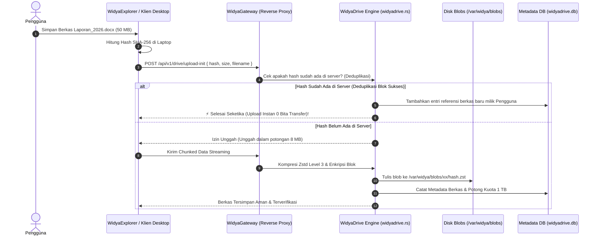

# Panduan Konfigurasi Penyimpanan Server WidyaWorkspace (1 TB Storage Engine) 💾⚙️

> **Spesifikasi Teknis Pengaturan Backend Storage, Ingest Pipeline, Kuota 1 TB & Deduplikasi CAS**  
> *Content-Addressable Storage (CAS) · Resumable Chunked Upload · Kompresi Zstd · Multi-Tier Storage (Hot/Warm/Cold)*

---

## 1. Pendahuluan

Layanan penyimpanan cloud **WidyaWorkspace** (dengan kuota 1 TB per pengguna) mengandalkan modul berdaulat [src/office/widyadrive.rs](file:///home/devops/widya-lang/src/office/widyadrive.rs). 

Di sisi server, arsitektur penyimpanan dirancang bukan sekadar menyimpan berkas secara mentah di folder (seperti FTP biasa yang boros dan rentan korupsi), melainkan menggunakan teknologi **Content-Addressable Storage (CAS) Berperforma Tinggi**:
- **Deduplikasi Tingkat Blok:** Dokumen atau lampiran identik hanya memakan ruang disk 1 kali di server fisik.
- **Kompresi Zstandard Real-Time:** Menekan ukuran berkas sebesar 40–60% sebelum ditulis ke disk.
- **Streaming Chunks (Resumable Upload):** Mengunggah berkas besar (video/dokumen ber-gigabyte) dapat dilanjutkan jika koneksi internet terputus di tengah jalan.

---

## 2. Struktur Direktori & Partisi Disk di Server

Pada server backbone (baik server sewaan Hetzner, IDCloudHost, atau server on-premise), struktur penyimpanan ditata rapi di direktori `/var/widya/`:

```
/var/widya/
├── metadata/                          # Database Relasional Metadata Berkas & Akun
│   ├── widyadrive.db                  # Daftar berkas, kepemilikan, versi CRDT, hak akses ACL
│   └── billing_quota.db               # Batas kuota (1 TB), masa aktif langganan, log QRIS
├── blobs/                             # Wadah Objek Data CAS (Content-Addressable Storage)
│   ├── 8f/                            # Dikelompokkan berdasarkan 2 karakter awal hash SHA-256
│   │   └── 8f3b99a...c1.zst           # Bongkahan berkas terkompresi Zstd & terenkripsi
│   └── e3/
│       └── e3b0c44...b8.zst
├── incoming/                          # Staging area sementara untuk upload berkas terputus (resumable)
└── cache/                             # Cache NVMe super cepat untuk berkas yang sering dibuka
```

---

## 3. Alur Kerja Unggah Berkas (*Ingest Pipeline*)

Ketika pengguna mengunggah dokumen dari desktop WidyaOS atau aplikasi WidyaWriter:



---

## 4. Mekanisme Penegakan Kuota 1 TB (*Quota Enforcement*)

Bagaimana server memastikan pengguna mematuhi batas kuota 1 TB (1.000 GB)?

1. **Pengecekan Kuota Waktu-Nyata (*Pre-Flight Check*):**  
   Sebelum potongan data pertama diterima, server menjalankan query cepat pada basis data:
   $$\text{Kapasitas Terpakai} + \text{Ukuran Berkas Baru} \le \text{Kuota Maksimal (1 TiB)}$$
   $$\text{current\_usage\_bytes} + \text{data.len()} \le 1.099.511.627.776 \text{ bytes}$$
2. **Respon Jika Kuota Penuh:**  
   Jika pengguna mencoba mengunggah melebihi kuota 1 TB, server mengembalikan kode `ERR_QUOTA_EXCEEDED (HTTP 413)`. Di desktop WidyaOS muncul pemberitahuan ramah: *"Penyimpanan WidyaDrive Anda telah mencapai batas 1 TB. Silakan bersihkan file sampah atau hubungi admin."*

---

## 5. Arsitektur Bertingkat (*Storage Tiering: Hot, Warm, Cold*)

Untuk menekan biaya server tanpa mengorbankan kecepatan akses pengguna:

```
┌────────────────────────────────────────────────────────────────────────┐
│                        STORAGE TIERING WIDYADRIVE                      │
├─────────────────────┬───────────────────────┬──────────────────────────┤
│ TINGKATAN (TIER)    │ MEDIA PENYIMPANAN     │ PERILAKU DATA            │
├─────────────────────┼───────────────────────┼──────────────────────────┤
│ **1. Hot Tier**     │ NVMe SSD Gen4 Cepat   │ Berkas aktif yang dibuka │
│                     │ (Latensi < 0,1 ms)    │ dalam 14 hari terakhir   │
├─────────────────────┼───────────────────────┼──────────────────────────┤
│ **2. Warm Tier**    │ SATA HDD / StorageBox │ Berkas berumur 15 s/d 90 │
│                     │ (Latensi ~10 ms)      │ hari yang jarang diakses │
├─────────────────────┼───────────────────────┼──────────────────────────┤
│ **3. Cold Tier**    │ Wasabi / S3 Archive   │ Arsip lama (> 90 hari),  │
│                     │ (Biaya ~$1/TB/bulan)  │ di-stream saat diklik    │
└─────────────────────┴───────────────────────┴──────────────────────────┘
```

---

## 6. Berkas Konfigurasi Server (`/etc/widya/widyadrive.toml`)

Konfigurasi server disimpan dalam format TOML yang sangat mudah dibaca:

```toml
[server]
bind_address = "127.0.0.1:8080"
max_upload_chunk_mb = 8
workers = 16

[storage]
storage_root = "/var/widya/blobs"
cache_dir = "/var/widya/cache"
max_cache_size_gb = 50
enable_deduplication = true
compression_algorithm = "zstd"
compression_level = 3

[quota]
default_tier = "personal_pro"
personal_pro_bytes = 1099511627776    # Tepat 1 TB (1.024 GB)
free_trial_bytes   = 10737418240      # 10 GB Trial

[database]
db_driver = "widyabase_embedded"
db_path = "/var/widya/metadata/widyadrive.db"
connection_pool_size = 32

[security]
require_pqc_signature = true
allow_anonymous_public_links = false
encryption_at_rest = "aes_256_gcm"
```

---

## 7. Pengaturan Layanan Otomatis (*Systemd Service*)

Agar layanan otomatis berjalan saat server dinyalakan atau me-restart otomatis jika ada gangguan:

Buat berkas `/etc/systemd/system/widyadrive.service`:
```ini
[Unit]
Description=WidyaDrive Cloud Storage 1TB Service
After=network.target

[Service]
Type=simple
User=widya-daemon
Group=widya-daemon
ExecStart=/usr/local/bin/widya storage serve --config /etc/widya/widyadrive.toml
Restart=always
RestartSec=3
LimitNOFILE=65535
MemoryHigh=4G
MemoryMax=6G

[Install]
WantedBy=multi-user.target
```

Jalankan dan aktifkan layanan dengan perintah:
```bash
sudo systemctl daemon-reload
sudo systemctl enable --now widyadrive.service
sudo systemctl status widyadrive.service
```

Layanan penyimpanan cloud 1 TB WidyaWorkspace kini aktif, terproteksi, dan siap melayani pengguna di seluruh dunia secara berdaulat!
