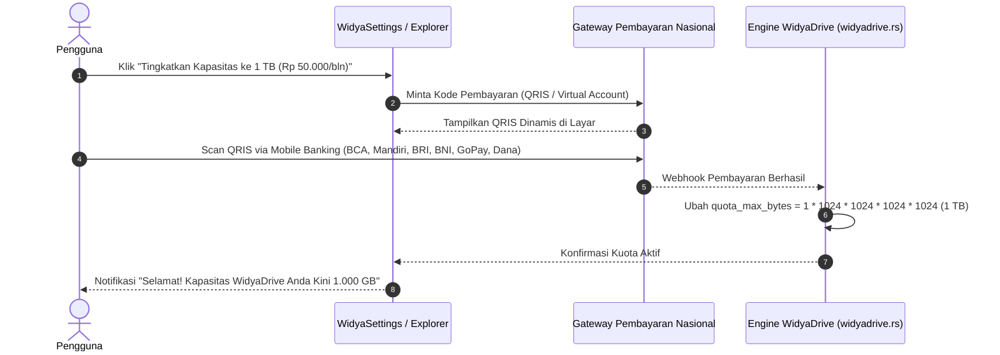

# Spesifikasi Layanan Berlangganan WidyaWorkspace & Penyimpanan 1 TB Cloud 🏢☁️

> **Model Bisnis, Tarif Layanan, Integrasi Desktop & Infrastruktur Penyimpanan Cloud Berdaulat**  
> *1 TB E2EE Storage Per-User · Files On-Demand (Smart Sync) · Tarif Terjangkau · Kepatuhan Kedaulatan Data Nasional*

---

## 1. Pendahuluan & Nilai Strategis

Dalam ekosistem perkantoran modern, ketergantungan pada layanan cloud asing (seperti Microsoft 365 / OneDrive seharga ~Rp 96.000/bln atau Google Workspace seharga ~Rp 180.000/bln) menimbulkan dua masalah besar:
1. **Kebocoran Devisa Nasional:** Miliaran rupiah mengalir keluar negeri setiap bulan hanya untuk membayar sewa storage cloud.
2. **Kedaulatan Data & Risiko Hukum:** Data dokumen rahasia instansi, kementerian, BUMN, dan data pribadi masyarakat tersimpan di server asing di luar yurisdiksi hukum Indonesia (rentan terhadap *US CLOUD Act*).

**WidyaWorkspace** hadir sebagai solusi perkantoran dan cloud storage terpadu berbasis stack kedaulatan Widya-Lang ([src/office/workspace.rs](file:///home/devops/widya-lang/src/office/workspace.rs) dan [src/office/widyadrive.rs](file:///home/devops/widya-lang/src/office/widyadrive.rs)) yang menawarkan **penyimpanan 1 TB per pengguna dengan tarif yang jauh lebih kompetitif, aman, dan berdaulat**.

---

## 2. Struktur Paket & Tarif Layanan (Pricing Matrix)

```
┌────────────────────────────────────────────────────────────────────────────────────────┐
│                          SKEMA TARIF LAYANAN WIDYAWORKSPACE                            │
├────────────────────┬────────────────────┬────────────────────┬─────────────────────────┤
│ FITUR / SPESIFIKASI│ PAKET GRATIS       │ PAKET PERSONAL PRO │ PAKET ENTERPRISE        │
│                    │ (STARTER BERDAULAT)│ (1 TB POPULER)     │ (KEMENTERIAN / BUMN)    │
├────────────────────┼────────────────────┼────────────────────┼─────────────────────────┤
│ Kapasitas Storage  │ **15 GB**          │ **1 TB (1.000 GB)**│ **1 TB/user** (Pooled)  │
│ Tarif Bulanan      │ **GRATIS (Rp 0)**  │ **Rp 50.000** /bln │ **Rp 75.000** /user/bln │
│ Tarif Tahunan      │ **GRATIS (Rp 0)**  │ **Rp 500.000** /thn│ **Rp 750.000** /user/thn│
│ Email @widya.email │ ✓ Aktif (Integ.)   │ ✓ Aktif (Prioritas)│ ✓ Custom Domain Lembaga │
│ Suite Produktivitas│ Full WidyaOffice   │ Full WidyaOffice   │ Full Suite + Admin Hub  │
│ Ukuran File Maks.  │ 500 MB per berkas  │ Tidak Terbatas     │ Tidak Terbatas          │
│ Riwayat Versi File │ 30 Hari            │ Tidak Terbatas     │ Tidak Terbatas (Audit)  │
│ Smart Sync Desktop │ Unduh Biasa        │ Files On-Demand ☁️ │ Files On-Demand + Group │
│ Kriptografi        │ Standar E2EE       │ E2EE ML-KEM-768    │ HSM PKCS#11 Kunci Lembaga│
│ Kuota AI Compute   │ 1 Jam / bulan      │ 15 Jam / bulan     │ Dedicated GPU Cluster   │
└────────────────────┴────────────────────┴────────────────────┴─────────────────────────┘
```

---

## 3. Integrasi Desktop: *Files On-Demand (Smart Sync)* di WidyaOS

Kapasitas 1 TB tidak akan menghabiskan SSD laptop pengguna yang mungkin hanya berukuran 256 GB atau 512 GB. WidyaOS menerapkan teknologi **Smart Sync (Files On-Demand)** di dalam **WidyaExplorer**:

```
┌────────────────────────────────────────────────────────────────────────┐
│  WidyaExplorer - Drive Penyimpanan Cloud                               │
├────────────────────────────────────────────────────────────────────────┤
│ ☁️ WidyaDrive (1.000 GB Kuota Langganan - Terpakai: 142 GB)            │
├────────────────────────────────────────────────────────────────────────┤
│ Nama Dokumen                   Ukuran    Status Sinkronisasi           │
│ 📝 Kontrak_Vendor_2026.docx    8.4 MB    🟢 Tersimpan di Laptop (Offline)│
│ 📊 Rekap_Anggaran_Nasional.xlsx 42.1 MB   ☁️ Cloud-Only (Hemat Memori)   │
│ 📽️ Video_Dokumentasi_4K.mp4    4.2 GB    ☁️ Cloud-Only (Streaming Cepat)│
│ 📕 Arsip_Ijazah_Digital.pdf    120 KB    🔄 Sedang Sinkronisasi (95%)   │
└────────────────────────────────────────────────────────────────────────┘
```

### 3 Status Berkas Cerdas:
1. ☁️ **Cloud-Only:** Berkas berada di cloud dan hanya menampilkan metadata ikon di laptop (mengonsumsi 0 bita ruang SSD). Saat di-klik ganda, berkas di-stream secara instan.
2. 🟢 **Available Offline (Tersedia Offline):** Berkas diunduh dan disimpan permanen di laptop, dapat diedit kapan saja meskipun tidak ada koneksi internet.
3. 🔄 **Syncing (Sinkronisasi Otomatis):** Setiap kali dokumen diubah dan disimpan di WidyaWriter/WidyaCalc, perubahannya otomatis disinkronkan ke server secara delta (hanya mengunggah bagian yang berubah, bukan seluruh berkas).

---

## 4. Keamanan & Kedaulatan Data: *Zero-Knowledge E2EE*

Masalah utama layanan cloud konvensional adalah administrator provider dapat melihat atau memindai berkas pengguna untuk kepentingan penargetan iklan atau pelatihan AI.

**Di WidyaWorkspace, privasi dijamin secara kriptografis:**
1. **Enkripsi Sisi Pengguna (*Client-Side Encryption*):** Dokumen dienkripsi di laptop pengguna sebelum dikirim ke jaringan menggunakan standar kriptografi pasca-kuantum **NIST FIPS 203 (ML-KEM-768)** dan **AES-256-GCM**.
2. **Kunci Enkripsi Dimiliki Pengguna:** Server WidyaWorkspace hanya menyimpan blok data biner terenkripsi (*ciphertext*). Provider cloud **tidak memiliki kunci untuk membaca isi dokumen**.
3. **Kepatuhan Regulasi Nasional:** Menjamin kepatuhan 100% terhadap **UU No. 27 Tahun 2022 tentang Pelindungan Data Pribadi (UU PDP)** dan **PP No. 71 Tahun 2019 tentang PSTE** karena seluruh infrastruktur berpusat di wilayah hukum Republik Indonesia.

---

## 5. Alur Berlangganan 1-Klik & Integrasi Pembayaran Nasional

Aktivasi layanan dirancang sangat mudah langsung dari antarmuka WidyaOS tanpa perlu keluar membuka browser rumit:



Waktu dari scan QRIS hingga kapasitas 1 TB aktif di laptop pengguna berlangsung dalam waktu **< 3 detik** secara instan!

---

## 6. Efisiensi Infrastruktur: Deduplikasi & Kompresi Berdaulat

Untuk menekan biaya operasional server agar tarif Rp 50.000/bulan tetap menguntungkan secara bisnis:
- **Deduplikasi Tingkat Blok (Block-Level Deduplication):** Jika 100 staf dalam satu instansi menyimpan salinan template dokumen atau file PDF panduan yang sama berukuran 50 MB, WidyaDrive hanya menyimpan file tersebut satu kali di server dengan referensi pointer terenkripsi.
- **Kompresi Zstandard Real-Time:** Seluruh berkas otomatis dikompresi hingga 40–60% lebih hemat sebelum ditulis ke disk penyimpanan NVMe server.
- **Biaya Penyimpanan Efektif:** Biaya penyimpanan riil untuk 1 TB data efektif terpangkas menjadi rata-rata ~400 GB, memberikan margin laba operasional yang sangat sehat bagi pengelola layanan.
