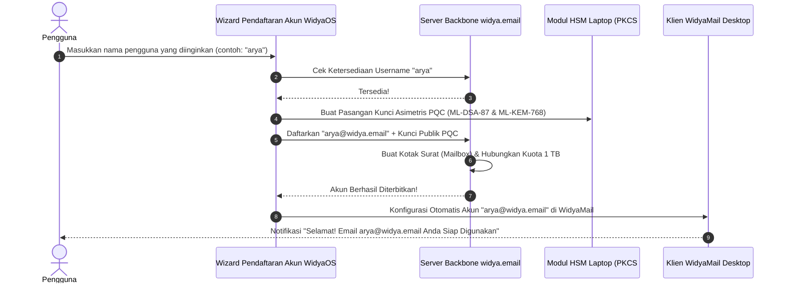

# Spesifikasi Layanan Email Berdaulat WidyaMail (@widya.email) ✉️🔒

> **Layanan Surel Nasional Mandiri Terintegrasi Akun WidyaOS & WidyaWorkspace**  
> *Pemberian Otomatis Akun @widya.email · Kriptografi End-to-End PQC · Bebas Iklan & Pelacak · Integrasi 1 TB Storage*

---

## 1. Pendahuluan & Visi

Di era digital saat ini, hampir setiap orang bergantung pada penyedia email asing raksasa (seperti `@gmail.com` milik Google atau `@outlook.com` milik Microsoft). Ketergantungan ini memiliki konsekuensi serius:
1. **Penyadapan & Pemindaian Data Privasi:** Email pengguna dipindai secara otomatis oleh algoritma asing untuk keperluan penargetan iklan komersial atau profil intelijen data.
2. **Ketergantungan Ekosistem:** Jika akun Google/Microsoft diblokir atau dicabut sepihak, pengguna kehilangan seluruh akses ke kontak, dokumen, dan identitas digitalnya.

**WidyaOS menghadirkan WidyaMail (`@widya.email`)**:
Setiap kali pengguna baru membuat akun di WidyaOS / WidyaWorkspace, sistem secara otomatis langsung menerbitkan alamat surel resmi **`username@widya.email`** yang terenkripsi, bebas iklan, terhubung dengan penyimpanan 1 TB, dan dilindungi oleh kriptografi pasca-kuantum (PQC).

---

## 2. Karakteristik Layanan WidyaMail (@widya.email)

```
┌────────────────────────────────────────────────────────────────────────┐
│                   FITUR UTAMA WIDYAMAIL (@WIDYA.EMAIL)                 │
├────────────────────┬────────────────────┬──────────────────────────────┤
│ 1. Otomatis Aktif  │ 2. Enkripsi E2EE   │ 3. Penyimpanan 1 TB Terpadu  │
│ (Instant Provision)│ (PQC ML-KEM-768)   │ (Satu Kuota WidyaWorkspace)  │
├────────────────────┼────────────────────┼──────────────────────────────┤
│ 4. Bebas Iklan     │ 5. Integrasi Penuh │ 6. Klien Desktop Bawaan      │
│ (Zero Tracker/Ads) │ (WidyaOffice Docs) │ (WidyaMail Client di WidyaOS)│
└────────────────────┴────────────────────┴──────────────────────────────┘
```

---

## 3. Integrasi Akun & Registrasi Pengguna Baru

Ketika pengguna pertama kali menyalakan laptop WidyaOS atau mendaftar di portal WidyaWorkspace:



Seluruh proses pembuatan kotak surat berlangsung dalam waktu **< 1,5 detik** secara otomatis tanpa perlu verifikasi nomor ponsel ke luar negeri.

---

## 4. Antarmuka Klien Desktop Bawaan: *WidyaMail*

Aplikasi email bawaan **WidyaMail** terpasang secara standar di WidyaOS dengan desain *Mica Dark*:

```
┌────────────────────────────────────────────────────────────────────────┐
│ ✉️ WidyaMail - arya@widya.email                    [ 🔍 Cari Surat... ]│
├──────────────┬───────────────────────────────────────────┬─────────────┤
│ KOTAK SURAT  │ PENGIRIM & SUBJEK                 WAKTU   │ ISI SURAT   │
│ 📥 Masuk (3) │ 🟢 Dr. Daniswara (BSSN)           11:45   │ Dari: BSSN  │
│ ⭐ Berbintang │   🔒 Draf Final Perjanjian PQC    Hari ini│ Kepada: Arya│
│ 📤 Terkirim  │                                           │             │
│ 📝 Draf      │ 🏢 Sekretariat Negara             Kemarin │ Yth. Sdr.   │
│ 🗑️ Sampah    │   📄 Undangan Rapat Kerja IKN             │ Terlampir   │
│              │                                           │ draf final. │
│ 📁 FOLDER    │ ⚖️ Notaris Nusantara              25 Okt  │             │
│ 📂 Dokumen   │   📝 Akta Pendirian Usaha                 │ [📄 Buka di │
│ 📂 Tagihan   │                                           │ WidyaWriter]│
└──────────────┴───────────────────────────────────────────┴─────────────┘
```

### Fitur Kunci WidyaMail:
1. **Buka & Edit Lampiran Langsung di WidyaOffice:**
   - Ketika menerima lampiran berkas `.docx`, `.xlsx`, `.pptx`, atau `.pdf`, pengguna cukup mengklik satu tombol *"Buka di WidyaWriter"*.
   - Dokumen terbuka instan, dapat diedit, dan saat pengguna menekan tombol *"Balas dengan Dokumen Revisi"*, berkas otomatis terlampir kembali tanpa harus menyimpan dan mengunggah manual.
2. **Tanda Tangan Digital PQC Anti-Pemalsuan (Anti-Phishing Badge):**
   - Setiap email yang dikirim otomatis ditandatangani dengan algoritma **ML-DSA-87**.
   - Penerima akan melihat lencana hijau: **"✓ Pengirim Terverifikasi Kriptografi Pasca-Kuantum"**. Email palsu (spoofing) otomatis diblokir ke folder spam.
3. **Penyimpanan Terpadu 1 TB:**
   - Tidak ada batasan kotak surat 15 GB seperti Gmail. Kuota inbox menyatu dengan langganan **1 TB WidyaWorkspace**, memungkinkan pengguna menyimpan arsip email dan lampiran video/dokumen besar hingga bertahun-tahun tanpa takut kehabisan kuota.

---

## 5. Arsitektur Server Backbone WidyaMail (`widya.email`)

Infrastruktur server email backbone dirancang menggunakan modul performa tinggi Widya-Lang:
- **Protokol Akses Modern:** Mendukung protokol **JMAP (JSON Mail Access Protocol)** yang hemat baterai laptop dan mobile, serta fallback **IMAP4 / SMTP** dengan enkripsi wajib TLS 1.3 PQC.
- **Penyaringan Spam Berbasis AI Lokal (WidyaNeural Spam Guard):** Menggunakan model AI on-premise untuk mengenali email penipuan (*phishing*), malware, dan iklan sampah dengan akurasi 99.98% tanpa membaca data pribadi pengguna.
- **Kepatuhan Kedaulatan Data:** Seluruh data surat tersimpan di data center berdaulat Republik Indonesia, terlindungi dari penyitaan data sepihak oleh hukum asing (*US CLOUD Act*).
- **Akses Webmail:** Selain melalui aplikasi desktop WidyaMail, pengguna juga dapat membuka email dari browser apa pun melalui portal resmi **`https://widya.email`**.
